  <b>English</b> | <a href="./README.zh-CN.md">简体中文</a>

  

### `~/src`

<table>
  <tr>
    <td width="100%" valign="top">
      <a href="https://github.com/The-garden-of-sinner/MDAP">https://img.shields.io/badge/MDAP-repository-8957E5?style=for-the-badge&logo=github&logoColor=white</a>    
        
      Representative research work (<i>Multi-view Disentangled and Adaptive Preference Learning for Cross-Domain Recommendation</i>). Multi-view feature disentanglement &amp; adaptive preference transfer for cross-domain recommendation.
        
        
    </td>
  </tr>
  <tr>
    <td width="50%" valign="top">
      <a href="https://github.com/The-garden-of-sinner/token-trace">https://img.shields.io/badge/token--trace-repository-0E7490?style=for-the-badge&logo=github&logoColor=white</a>
        
         
        
      A lightweight telemetry tool that makes LLM API calls less of a black box — token usage tracking and invocation observability across multi-turn workflows.
        
        
    </td>
    <td width="50%" valign="top">
      <a href="https://github.com/The-garden-of-sinner/SuperV-cliphist">https://img.shields.io/badge/SuperV--cliphist-repository-238636?style=for-the-badge&logo=github&logoColor=white</a>
        
         
        
      Brings <code>Super+V</code> clipboard history to Linux &amp; KylinOS: text, rich text, images and files pasted back in original format.
        
        
    </td>
  </tr>
</table>

### `~/telemetry`

  

<code>[+] cat /proc/observer/architecture</code>

 
